# Enterprise RAG Architecture

TrashTheTest is a self-hosted study platform. This document describes the
retrieval and indexing architecture **as implemented**, including known
limits. It is not a claim of production readiness.

## Pipeline

```mermaid
flowchart LR
  U[Upload] --> Q[Postgres job queue]
  Q --> W[Worker: document_processing]
  W --> EX[Extraction: PyMuPDF / pypdf / pdfplumber / PP-OCRv6]
  EX --> CH[Structure-aware chunker]
  CH --> EM[Qwen3-Embedding-0.6B 1024d]
  EM --> DB[(Postgres + pgvector)]
  DB --> HY[Hybrid retrieval: dense + FTS, weighted RRF]
  HY --> RR[Reranker with timeout fallback]
  RR --> RAG[Tutor / notes / practice]
  RAG --> SC[Semantic cache]
```

Stages: `validate -> extract -> structure -> validate2 -> chunk -> embed ->
complete`, resumable through `_stages_done`. Embeddings are written to the
legacy BYTEA column **and** to `chunks.embedding_v`, the column retrieval
actually filters on. The HNSW index is migration-managed.

## Retrieval

- Dense: pgvector cosine (`<=>`), HNSW, model-tag filter.
- Sparse: generated `tsv` + GIN index, `ts_rank`.
- Fusion: weighted RRF (default weights 1.0, k=60) in one SQL statement.
- Modes: `dense`, `sparse`, `hybrid`, selected per request.
- Filters: project, document, user, and `source_types`.
- `min_similarity` is a **dense cosine** threshold. It is never compared to
  an RRF score.
- Rerank: bge-reranker-v2-m3 when memory allows, MiniLM fallback otherwise,
  bounded by a 2s budget; timeout degrades to RRF order.
- Citations: chunk-id allowlist + non-empty text. The resolver also supports
  normalised quote-span containment, but the tutor currently builds citations
  directly from retrieved chunks and does not pass a quote to it.

## Storage and lifecycle

- Documents carry `version`, `embedding_model_version`, `chunk_config`.
- Reprocessing upserts chunks by `(document_id, content_hash)` and deletes
  hashes no longer produced. Pages beyond the confirmed page count are pruned.
- `chunks.document_id` has `ON DELETE CASCADE`; deletion also explicitly
  removes chunks/pages and invalidates semantic-cache entries.
- Old document versions cannot contaminate retrieval because stale chunks are
  removed and cache identity includes document versions.

## Observability

Every retrieval writes a best-effort row to `retrieval_traces`: query,
mode, rerank flag, chunk ids, scores, latency, rerank latency, context-token
estimate, cache layer/hit. Document contents are not duplicated into traces;
the query text and ids are stored (redaction policy is a known gap).

## Security status (explicit)

Row-level security and full route-level authorisation are **not implemented**.
The audit found unauthenticated RAG-adjacent routes; S0 was deliberately
deferred by the project owner in favour of ML work. Retrieval still applies
project/document/user filters when a caller is present. Do not describe this
deployment as multi-tenant secure.

## Failure behaviour

- Embedding batch failures are counted; partial/incomplete embeddings fail the
  job so the queue can retry. Persisted batches are reused.
- Retrieval failures roll back the aborted statement and degrade to the
  offline fallback (flagged in metadata).
- Cache failures are misses, never request failures.
