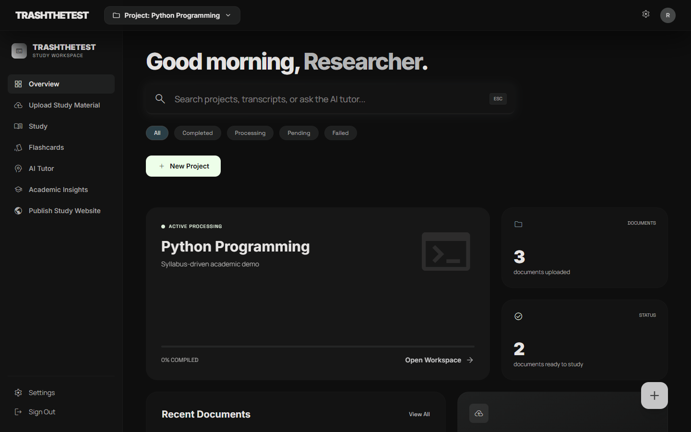
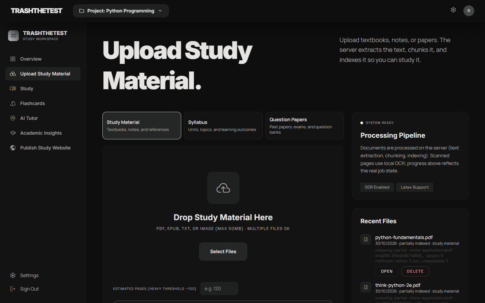
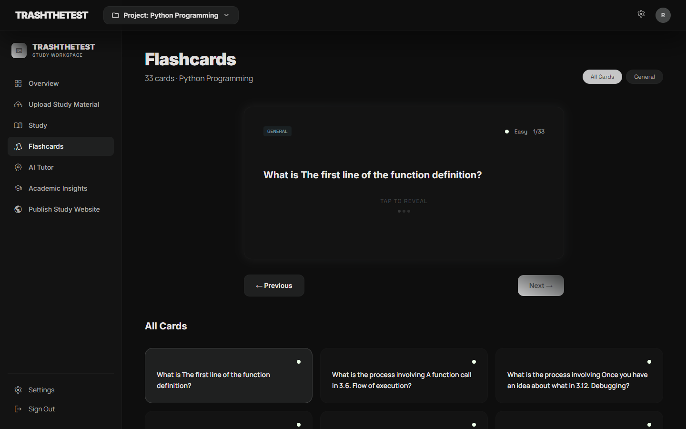
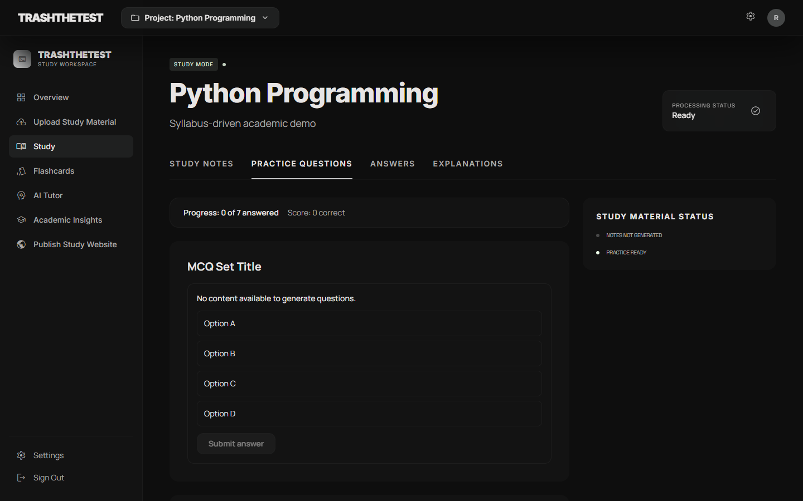
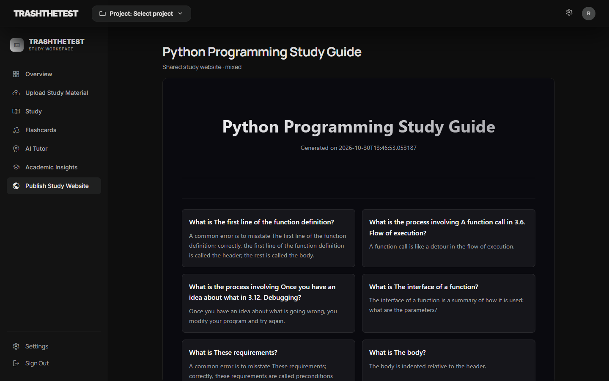
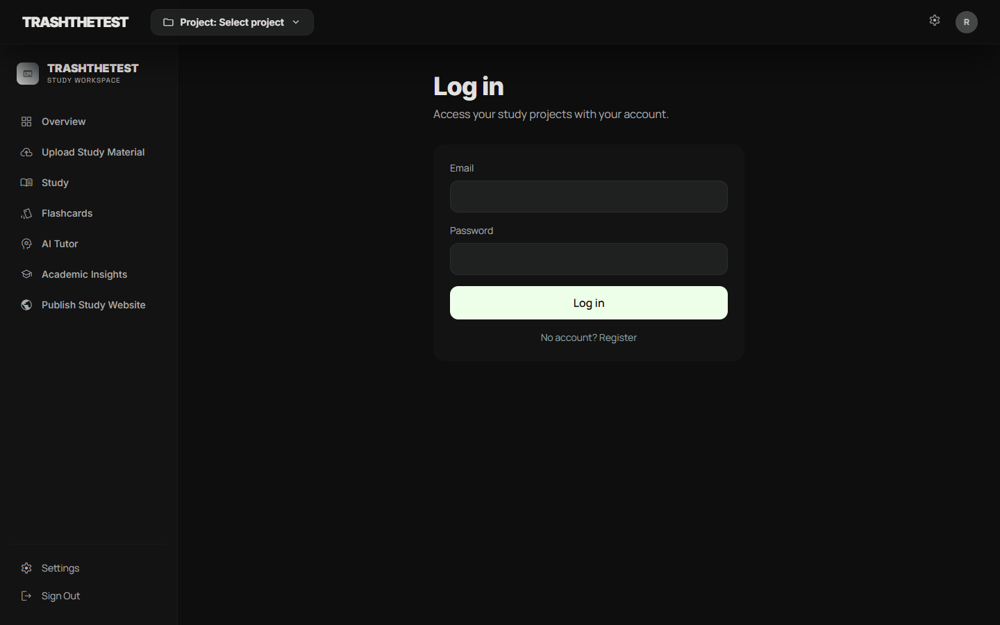
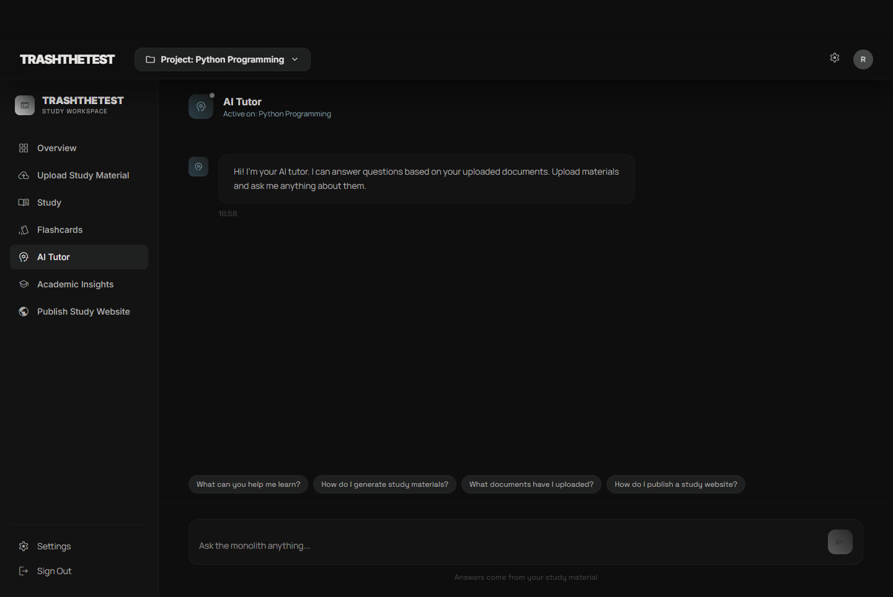
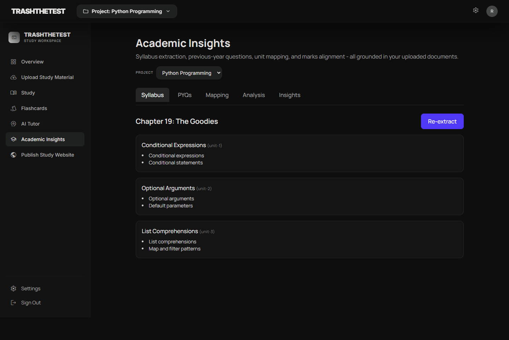
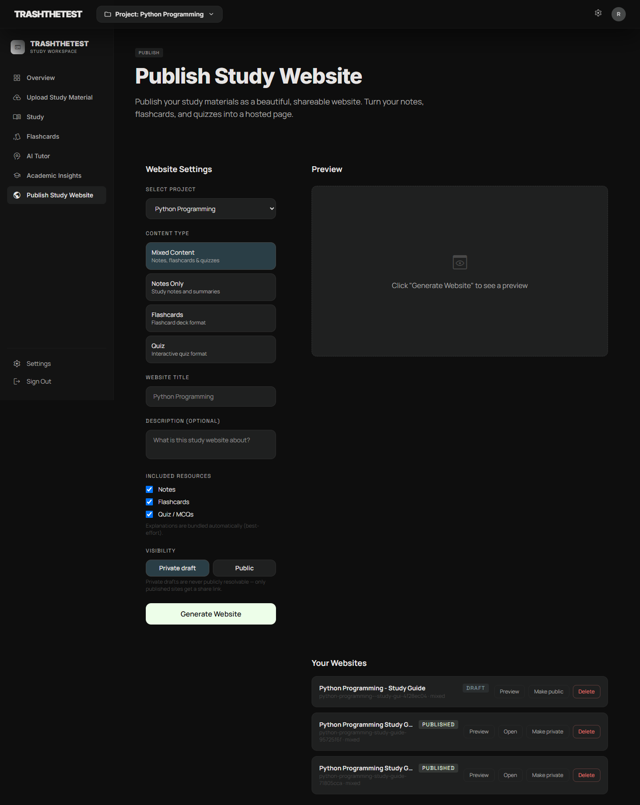
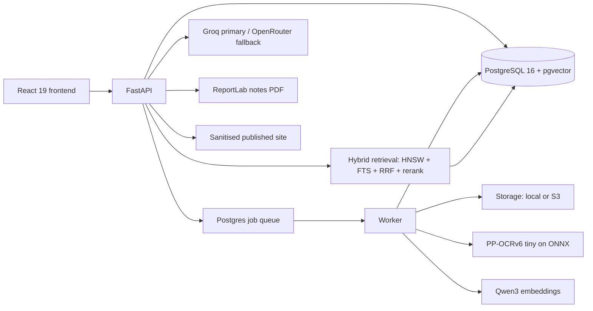

<div align="center">

# TrashTheTest

**Upload academic material. Get notes, flashcards, practice questions, an AI tutor and a syllabus-aware study website you can publish.**

[](https://trashthetest.aakifmudel.xyz)
[](./LICENSE)
[](https://www.python.org)
[](https://fastapi.tiangolo.com)
[](https://react.dev)
[](https://github.com/pgvector/pgvector)
[](#self-hosting)

[Live site](https://trashthetest.aakifmudel.xyz) - [Features](#features) - [How it works](#how-it-works) - [Quick start](#quick-start) - [Self-hosting](#self-hosting) - [Troubleshooting](#troubleshooting)

</div>



---

## Screenshots

| | |
|---|---|
| **Upload** - single or multi-file, async processing with honest stage progress | **Flashcards** - atomic, cited, difficulty-tagged; definitions become cloze |
|  |  |
| **Practice** - MCQs with explanation and source; unfillable cells are skipped | **Published site** - public URL, no login for readers |
|  |  |

<details>
<summary>More screenshots - login, tutor, academic insights, publishing</summary>

| | |
|---|---|
| **Sign in** | **AI tutor** - project-scoped RAG with sources |
|  |  |
| **Academic insights** | **Publish** - title, slug, visibility, share link |
|  |  |

</details>

---

## What this is

TrashTheTest is a self-hosted study platform. You upload a textbook, lecture notes, a syllabus or previous-year papers, and it builds a structured academic model of the material: pages, topics, subtopics and concepts, each with provenance.

Everything it generates is grounded in retrieved source chunks, with page-level citations, and validated before it is persisted. Anything that cannot be supported becomes an explicit gap rather than invented filler.

The output is not a chat window. It is a study set:

- **Notes** generated topic by topic, synthesised in source order, and rendered as a real PDF with a table of contents, bookmarks and page numbers.
- **Flashcards** that are atomic and source-anchored, with cloze cards for definitions.
- **Practice questions** with explanations, citations and difficulty, leaving cells unfilled when there is not enough evidence.
- **An AI tutor** scoped to the project, which skips retrieval for greetings and cites sources for academic questions.
- **Academic insights** that map a syllabus and PYQs onto topics with deterministic frequency, marks and coverage metrics.
- **A published study website** with a public slug URL, rendered from sanitised content.

It is built for one person's workspace, not a multi-tenant SaaS.

## Features

- **Ingestion** - native PDF extraction, quality gating, targeted PP-OCRv6 for scanned or poor pages, DOCX/TXT support.
- **Structure** - page-level provenance, a topic/subtopic/concept spine, deterministic junk filtering for covers, credits and running headers.
- **Retrieval** - Qwen3-Embedding-0.6B (1024d), pgvector HNSW, PostgreSQL FTS, RRF fusion, optional cross-encoder reranking.
- **Generation** - Pydantic-validated structured output, bounded repair, citation resolution, grounding checks, prompt-injection guards.
- **Notes PDF** - ReportLab with title page, TOC, hierarchical headings, page numbers, badges for coverage and a gaps report.
- **Jobs** - Postgres `SKIP LOCKED` queue with a dedicated worker, progress, cancellation, retries, resume and idempotency.
- **Auth** - JWT access and refresh tokens, Argon2id, revocation, project and document ownership on every route.
- **Providers** - Groq primary with key rotation, OpenRouter fallback, timeouts and typed errors; per-user keys encrypted at rest.
- **Publishing** - sanitised HTML, public and private visibility, preview parity with the published bytes.

## How it works



The document pipeline is deliberately boring and resumable:

```
upload -> validate -> extract/OCR -> structure -> chunk -> embed -> index -> complete
```

Generation only starts once a document is indexed. Notes are generated per topic from the spine, coverage-checked, repaired once where needed, then synthesised in source order and validated before rendering.

## Quick start

### Prerequisites

- Docker and Docker Compose
- A Groq API key (or an OpenRouter key)
- About 4 GB of RAM for CPU embeddings; more for large books

### 1. Configure

```bash
git clone https://github.com/ItsAakif/TrashTheTest.git
cd trashthetest
cp .env.example .env
```

Fill `.env`. At minimum:

```env
JWT_SECRET=<openssl rand -hex 32>
DATABASE_URL=postgresql+asyncpg://postgres:postgres@db:5432/trashthetest
GROQ_API_KEY=<your key>
OPENROUTER_API_KEY=<optional fallback>
CORS_ORIGINS=http://localhost:5174
```

### 2. Run

```bash
docker compose up -d --build
docker compose exec api alembic upgrade head
```

Open **http://localhost:5174**. The API health check is **http://localhost:8000/health**.

The frontend binds to 5174 so it does not collide with a Vite dev server on 5173. If you change the host port, add the new origin to `CORS_ORIGINS`.

### 3. Local development without containers

```bash
cd artifacts/ai-services
pip install -r requirements.txt
alembic upgrade head
uvicorn main:app --host 0.0.0.0 --port 8000

# in another terminal
python -m services.jobs.worker

cd artifacts/trash-the-test
pnpm install
pnpm dev
```

### Tests

```bash
cd artifacts/ai-services && pytest -q          # 777 tests
cd artifacts/trash-the-test && pnpm typecheck && pnpm build
```

## Self-hosting

TrashTheTest needs a persistent PostgreSQL database, a disk or object store, and one long-running worker. There is no broker to operate: the queue lives in Postgres.

### Docker Compose

```bash
cp .env.example .env
docker compose up -d --build
docker compose exec api alembic upgrade head
```

Mount a volume for PostgreSQL (`pgdata`) and one for the model cache (`modelcache`). The cache avoids re-downloading about 1 GB of embedding weights on every redeploy.

### Behind a reverse proxy

Terminate TLS in front of the frontend and API, set the public origins in `CORS_ORIGINS`, and keep `VITE_API_BASE_URL` pointing at the public API origin at build time. Provider keys stay server-side.

### Configuration reference

| Variable | Required | Purpose |
| --- | --- | --- |
| `JWT_SECRET` | yes | Signs access and refresh tokens. The app refuses to boot without it. |
| `DATABASE_URL` | yes | `postgresql+asyncpg://...` with pgvector available. |
| `CORS_ORIGINS` | yes | Comma-separated explicit allowlist. Wildcards with credentials are refused. |
| `GROQ_API_KEY` | one provider | Primary LLM. Supports rotation keys `GROQ_API_KEY_1..9`. |
| `OPENROUTER_API_KEY` | one provider | Fallback provider. |
| `STORAGE_BACKEND` | no | `local` (default) or `s3`. |
| `STORAGE_PATH` | local only | Directory for uploaded files. |
| `S3_ENDPOINT` / `S3_BUCKET` / `S3_REGION` / `S3_ACCESS_KEY` / `S3_SECRET_KEY` | s3 only | Object storage. |
| `REDIS_URL` | no | Cache and optional Celery bridge; not required for the job queue. |
| `EMBEDDING_MODEL` / `EMBEDDING_DIMENSIONS` | no | Defaults to Qwen3-Embedding-0.6B at 1024 dimensions. Changing this requires a reindex. |
| `OCR_PROVIDER` / `OCR_ENGINE` | no | Defaults to `ppocr-onnx` on CPU. |
| `NOTES_PER_TOPIC_TIMEOUT_S` / `NOTES_TOPIC_CONCURRENCY` | no | Notes bounds (120 s, 4). Slower providers produce explicit gaps. |

### Demo account

The local seed creates a demo account with a real university syllabus, a study excerpt, generated flashcards, practice questions and a published site:

```
email:    demo@trashthetest.dev
password: DemoPass!123
```

The demo project is built from Delhi University's *Programming using Python* syllabus and an
excerpt of Allen Downey's *Think Python* (Green Tea Press); both are downloaded at setup time
rather than vendored here.

## Troubleshooting

**Uploads sit at 0%.** Check that the worker is running (`docker compose ps`) and that its logs show claims. The queue is in Postgres; a stopped worker means jobs wait, not fail.

**Processing is slow on a large PDF.** Embedding runs on CPU by default at roughly 3-5 seconds per chunk. Use a smaller document for a demo, give the worker more cores, or move embeddings to a GPU service.

**Notes finish with gaps.** The per-topic timeout was reached for those topics. Gaps are intentional and listed in the PDF. Raise `NOTES_PER_TOPIC_TIMEOUT_S` or use a faster model.

**`websites` errors after an upgrade.** Run `alembic upgrade head`; the website columns and provider credentials are additive migrations.

**Provider errors.** Check `docker compose logs api | grep provider`. The router retries transient connection errors, rotates keys on rate limits, and fails over between Groq and OpenRouter. A model id that the provider has retired is reported as `unknown_model`.

## Known limitations

- **CPU embedding is the throughput floor.** Large textbooks take minutes to tens of minutes without a GPU worker.
- **Notes are bounded per topic.** Slow providers yield explicit gaps rather than unbounded jobs.
- **Syllabus extraction depends on the PDF.** Scanned or table-heavy syllabi may yield partial units; OCR is applied only when the text layer is missing.
- **Not a multi-tenant SaaS.** There is no team workspace, sharing or collaborative editing. Public study sites are read-only.
- Some live acceptance gates (HNSW `EXPLAIN`, provider failover under a real 429, 300-page runs, Puter) are not exercised in CI.

## Security and permissions

- JWT access and refresh tokens with Argon2id password hashing and revocation on password change.
- Every project, document, job and website route checks ownership; foreign resources return 404.
- Uploads are validated by magic bytes and size, stored under generated keys, and never exposed by filesystem path.
- Provider keys are server-side only; user-supplied keys are encrypted at rest and never returned.
- Generated website HTML is sanitised before persistence and rendering; scripts, unsafe URLs and event handlers are removed.
- Retrieved document text is treated as untrusted data and wrapped in data blocks with an injection guard.

## Project structure

```
artifacts/
  ai-services/       FastAPI app, worker, ingestion, retrieval, generation, PDF renderer
  trash-the-test/    React 19 frontend (Vite, TanStack Query, wouter)
  api-server/        legacy Express health gateway (not the product path)
lib/                 shared workspace packages
docs/screens/        screenshots used in this README
```

## Contributing

Issues and pull requests are welcome. Run `pytest -q` in `artifacts/ai-services` and `pnpm typecheck` in `artifacts/trash-the-test` before opening a PR, and keep diffs small and verifiable.

## Links

- Landing page: https://trashthetest.aakifmudel.xyz
- Source: https://github.com/ItsAakif/TrashTheTest
- Issues: https://github.com/ItsAakif/TrashTheTest/issues

## License

[MIT](./LICENSE). Use it, fork it, self-host it.